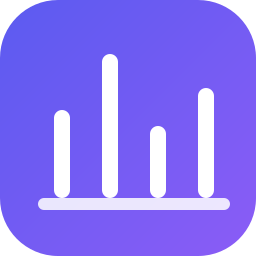
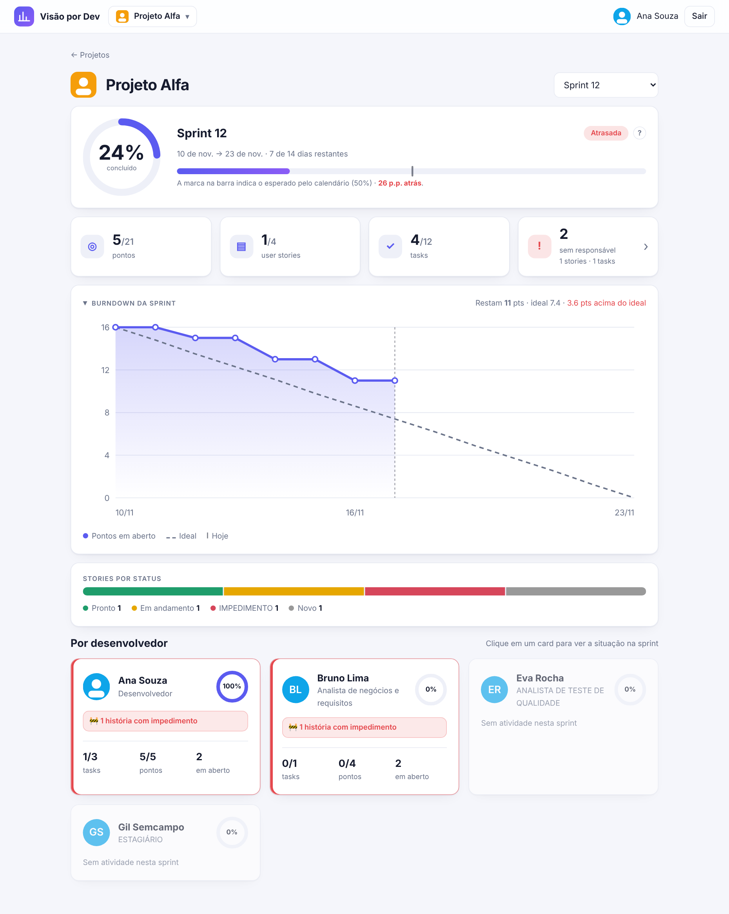
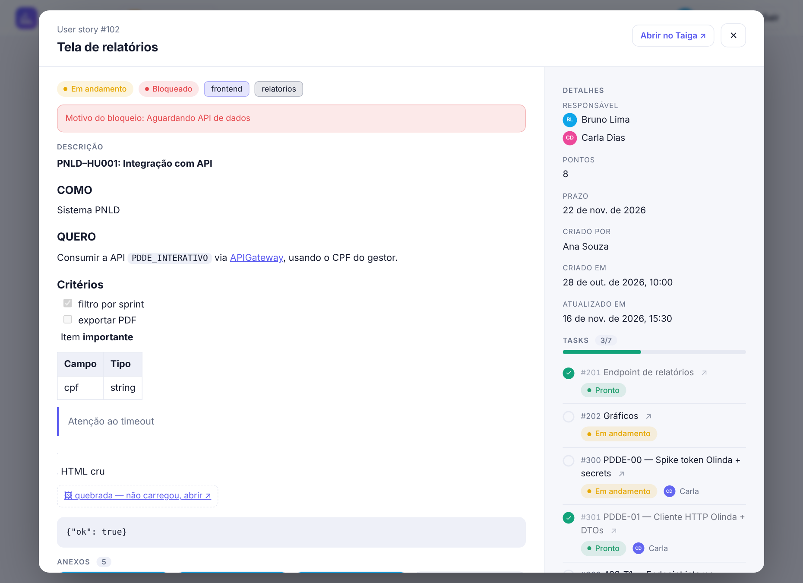
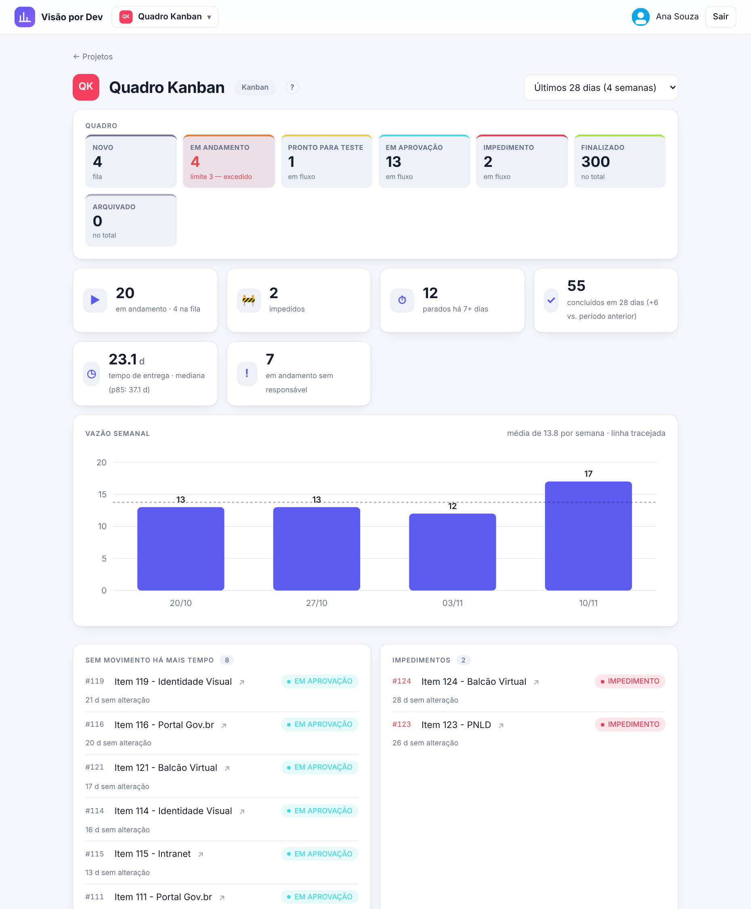
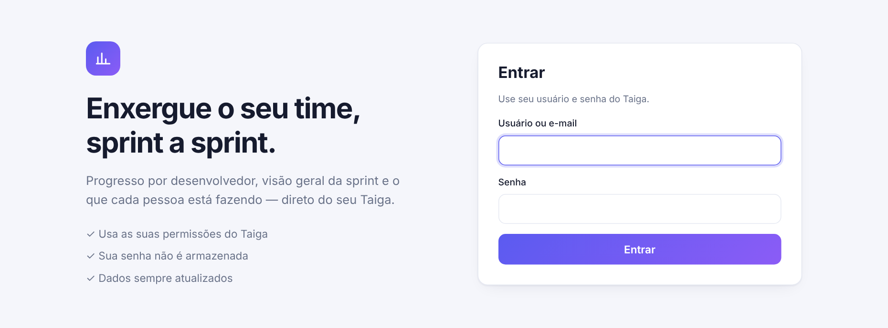
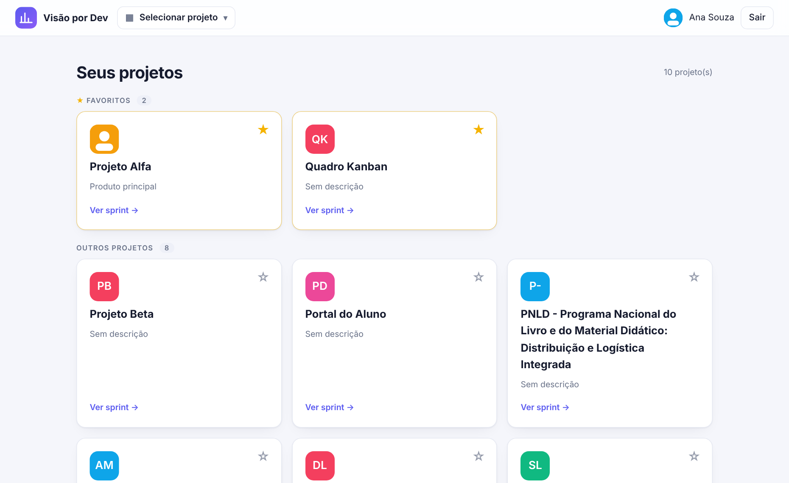
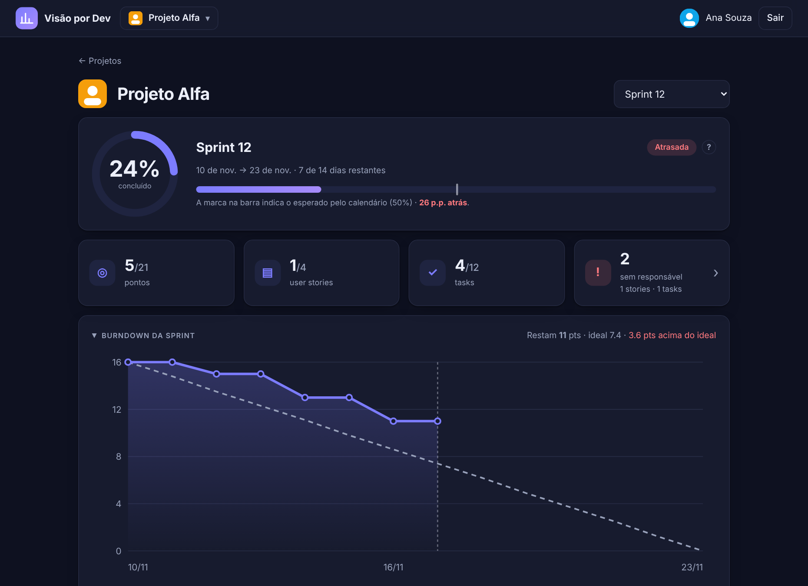
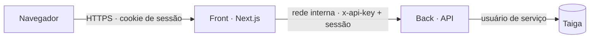

<div align="center">



# Taiga · Visão por Dev

**O que o Taiga não mostra: o andamento de cada pessoa do time, sprint a sprint — e o fluxo dos projetos Kanban.**

[](https://nextjs.org)
[](https://react.dev)
[](https://www.typescriptlang.org)
[](https://docs.taiga.io/api.html)


[Funcionalidades](#-funcionalidades) ·
[Arquitetura](#-arquitetura) ·
[Começando](#-começando) ·
[Configuração](#-configuração) ·
[Produção](#-produção-openshift) ·
[Critérios](#-critérios-dos-indicadores) ·
[Roadmap](#-roadmap)

<br />



</div>

<br />

## ✨ Por que existe

O Taiga é ótimo para organizar o trabalho, mas responder perguntas como *"quem está com o quê?"*, *"quem está impedido?"* ou *"essa sprint vai fechar no prazo?"* exige abrir quadro por quadro. Este projeto lê a API do Taiga (por meio da API própria, repositório `taiga-dev-view-back`) e monta essas visões — **sem alterar nada no Taiga**.

Cada pessoa entra com o **próprio login do Taiga** e só enxerga os projetos em que tem o papel **Servidor Dirti/Fiscal**. Os dados são consultados por um **usuário de serviço** (veja a [API](#-arquitetura)).

## 🧭 Funcionalidades

### Visão da sprint (projetos Scrum)

- **Ritmo da sprint** — progresso real contra o esperado pelo calendário, com selo *Acima do ritmo*, *No ritmo*, *Atrasada* ou *Fechada* e a diferença em pontos percentuais.
- **Burndown** do próprio Taiga, recolhível, com o resumo de quantos pontos a sprint está acima ou abaixo do ideal.
- **Um card por desenvolvedor**: progresso, pontos, tasks, itens em aberto e faixa vermelha 🚧 para quem está envolvido em **histórias com impedimento**.
- **Sem responsável**: o que ninguém assumiu, com a lista clicável.
- **Seletor de sprint** e **seletor de projeto** no topo (com busca e logos).
- Ícone **?** que explica cada critério com os números da sprint atual.

### Detalhe de cada pessoa e de cada item

- Página do dev com as stories e tasks agrupadas por status, e etiqueta de **bloqueada**.
- **Modal** com descrição em **Markdown renderizado** (tabelas, checklists, código, imagens), tasks da story, comentários e anexos.
- **Galeria de anexos** com visualizador: setas, teclado, deslize no celular e miniaturas.
- **Link ↗ para o item no próprio Taiga**, em todas as listas.

<div align="center">

</div>

### Projetos Kanban

Projetos sem o módulo Scrum (ou sem nenhuma sprint) ganham uma visão de **fluxo**, em janelas de 14, 28, 56 ou 84 dias:

- **Quadro** por coluna com totais e **limite de WIP** (em vermelho quando excedido).
- Em andamento, **impedidos**, **parados** há N dias, concluídos no período (vs. período anterior) e **tempo de entrega** (mediana e p85).
- **Vazão semanal** e cards por pessoa com os itens em andamento.
- Feito para quadros com **milhares de itens finalizados**: o total vem do cabeçalho `x-pagination-count` e só as páginas mais recentes são analisadas.

<div align="center">

</div>

### Conforto de uso

| | |
|---|---|
| ⭐ **Favoritos** | Estrela nos projetos; os favoritos sobem para o topo. Fica só no navegador de quem usa. |
| 🌗 **Claro e escuro** | Acompanha o tema do sistema. |
| 📱 **Responsivo** | Funciona no celular, sem rolagem horizontal. |
| 🔐 **Somente leitura** | Só faz `GET` na API (além do login). Não cria, edita nem apaga nada. |

<table>
<tr>
<td width="50%"></td>
<td width="50%"></td>
</tr>
<tr>
<td align="center"><sub>Login com a conta do Taiga</sub></td>
<td align="center"><sub>Projetos favoritos no topo</sub></td>
</tr>
</table>

<div align="center">

</div>

> As capturas usam o **modo demonstração** (dados fictícios). Veja [Testar sem um Taiga](#testar-sem-um-taiga).

## 🧱 Arquitetura

O sistema é dividido em **dois repositórios**, cada um com sua imagem de contêiner:

| Repositório | O que faz |
|---|---|
| **`taiga-dev-view-front`** (este) | Interface (Next.js). Só desenha a tela: não conhece o Taiga, as regras nem as credenciais. |
| **`taiga-dev-view-back`** | API (Fastify). Consulta o Taiga com um **usuário de serviço**, aplica papéis e métricas e entrega dados prontos. |



- O navegador só fala com o **front** (única `Route`). A API fica **dentro do cluster**, protegida por `NetworkPolicy` e por uma chave interna (`API_KEY`).
- **Login:** o front repassa usuário e senha à API, que confere no Taiga e **descarta o token** da pessoa; fica só uma sessão opaca, guardada no cookie `HttpOnly` (`Secure` e `__Host-` em produção).
- **Permissões:** a API confere o papel **Servidor Dirti/Fiscal** da pessoa em cada projeto. Como o usuário de serviço enxerga mais do que ela, essa regra é verificada em toda rota.
- O front mantém uma **cópia dos tipos** do contrato em `lib/api/types.ts`; ao mudar a API, atualize os dois lados (veja `docs/API.md` no repositório do back).

## 🚀 Começando

### Requisitos

- **Node.js 22.12 ou superior**.
- O repositório **`taiga-dev-view-back`** rodando (veja o README dele) e, nele, um Taiga real ou o simulado.

### Rodando localmente

```bash
# 1) API, em outro terminal (usa o Taiga simulado):
cd ../taiga-dev-view-back
npm install && npm run mock                       # Taiga simulado em :9000
TAIGA_URL=http://localhost:9000 TAIGA_SERVICE_USER=svc TAIGA_SERVICE_PASSWORD=senha npm run dev    # API em :8080

# 2) Este front:
cd ../taiga-dev-view-front
npm install
cp .env.example .env.local                        # no Windows (CMD): copy .env.example .env.local
npm run dev                                       # http://localhost:3000
```

Com o simulador, entre com **qualquer usuário** e a senha **`senha`**. Com um Taiga real, use o seu usuário e senha do Taiga (e configure a API conforme o README do back).

> 🪟 **Windows / PowerShell:** se o `npm` for bloqueado pela política de execução, use o CMD, `npm.cmd`, ou libere para o seu usuário com `Set-ExecutionPolicy -Scope CurrentUser -ExecutionPolicy RemoteSigned`.

## 🔧 Configuração

Em `.env.local` (veja o `.env.example`). Regras de negócio (`DEV_ROLES`, `KANBAN_STALE_DAYS`, `BLOCKED_STATUS_REGEX`, limites de login e de sessão, `TAIGA_WEB_URL`…) ficam **na API**; veja o README do back.

| Variável | Padrão | Para quê |
|---|---|---|
| `API_URL` | `http://localhost:8080` | Endereço **interno** da API (em produção, o Service do OpenShift). |
| `API_KEY` | *(vazia)* | Chave compartilhada com a API (`INTERNAL_API_KEY` lá). **Defina em produção.** |
| `TRUSTED_PROXY_HOPS` | `1` | Proxies confiáveis entre o cliente e o front (o roteador do OpenShift conta 1). O IP real é lido do **fim** do `X-Forwarded-For`, pulando esses proxies. |
| `API_TIMEOUT_MS` | `45000` | Tempo máximo de cada chamada à API. |

## 📐 Critérios dos indicadores

O ícone **?** de cada página mostra isto dentro do app, com os números da sprint atual.

| Indicador | Como é calculado |
|---|---|
| **Progresso da sprint** | Pontos das stories **concluídas** ÷ pontos totais (sem pontos, conta stories). Uma story só conta quando fecha inteira. |
| **Esperado pelo calendário** | Fração dos dias já decorridos, de forma linear (fins de semana contam). |
| **Ritmo** | 🔵 *Acima* se real > esperado + **10 p.p.** · 🔴 *Atrasada* se real + 10 p.p. < esperado · 🟢 *No ritmo* no restante · ⚪ *Fechada*. |
| **Progresso do dev** | Pontos concluídos ÷ pontos das stories de que é responsável; sem pontos, tasks concluídas ÷ tasks. Pontos de stories compartilhadas são divididos igualmente. |
| **Impedimento** | Story **aberta** com status que combine com `BLOCKED_STATUS_REGEX` **ou** bloqueada no Taiga. Marca quem é responsável e quem só tem tasks nela. |
| **Sem responsável** | Stories + tasks da sprint que ninguém assumiu. |
| **Kanban: em andamento** | Colunas abertas, exceto a primeira (a fila). |
| **Kanban: parados** | Em andamento sem alteração há `KANBAN_STALE_DAYS`+ dias (pela data da última modificação). |
| **Kanban: tempo de entrega** | Da criação à conclusão dos itens concluídos no período; mediana e percentil 85. |

> ⚠️ Pontos são estimativas do time e papéis diferentes não são comparáveis entre si. Use os indicadores para **conversar sobre o fluxo**, não para ranquear pessoas.

## 📡 Consumo do Taiga

O app evita sobrecarregar o Taiga. Contagens aproximadas de requisições feitas pela **API** a cada tela:

| Tela | Requisições |
|---|---|
| Página da sprint | ~6 + 2 de conferência de acesso (projeto, membros, sprints, stories, tasks, burndown) |
| Página do dev | ~5 |
| Abrir o modal de um item | ~5 (item, membros, histórico, tasks da story, anexos) |
| Kanban, 1ª visita (300 finalizados) | 12 |
| Kanban, visitas seguintes | 8 (finalizados em cache) |

A lista de projetos do cabeçalho fica em cache por 5 minutos. No Kanban, as colunas concluídas **não são baixadas por inteiro**: o total vem de `x-pagination-count` e são lidas no máximo 5 páginas de 100 itens. Imagens e anexos são carregados pelo **navegador** direto do Taiga.

## 🗂️ Estrutura

```
app/                              só rotas (o que define as URLs)
  page.tsx                        login
  projects/                       lista de projetos (favoritos)
  projects/[id]/                  sprint (Scrum) ou visão de fluxo (Kanban)
  projects/[id]/devs/[userId]/    situação de uma pessoa na sprint
  api/login · api/logout          ponte para a sessão da API (cookie)
  api/item                        detalhes de story/task para o modal (repassa à API)
  healthz                         sonda do OpenShift
  **/loading.tsx                  esqueletos de carregamento (lista, projeto, dev)
components/                       interface, agrupada por funcionalidade
  layout/                         header, forbidden, api-error (tratamento padrão de erros da API nas páginas)
  ui/                             primitives (Ring, Bar, Kpi, Chip…), skeleton (peças dos esqueletos), picture, lightbox, markdown, criteria-help
  projects/                       project-list, project-switcher, use-favorites
  sprint/                         sprint-picker, burndown, unassigned
  kanban/                         kanban-view (só desenha), kanban-chart, period-picker
  items/                          item-modal, item-skeleton
lib/
  api/                            client.ts (só servidor: chave interna, sessão, erros), types.ts (contrato, cópia), client-ip.ts
  utils/                          colors, links, periods, format (funções puras)
deploy/openshift/                 manifests
```

Esqueletos: cada rota tem um `loading.tsx` que o Next mostra na hora enquanto a página busca os dados; o modal de detalhes tem o seu. Use as peças de `components/ui/skeleton.tsx` e classes com prefixo `sk-` para a estrutura (não reutilize `.kpis`, `.overview`… para os seletores da página real não casarem com o esqueleto). Como a resposta já começou, um erro da API aparece na página (a página de erro do Next), e não mais como HTTP 500.

Convenções: páginas em `app/` buscam os dados (`apiGet`) e passam prontos aos componentes; o que lê a `API_KEY` (`lib/api/client.ts`) usa `server-only`, então o build falha se um componente de cliente o importar.

## 🧪 Testes

| Camada | Comando | O que cobre |
|---|---|---|
| Tipos | `npm run typecheck` | TypeScript em todo o projeto, inclusive os testes. |
| Unitários (Vitest) | `npm run test:unit` | Links, períodos e a leitura do IP do cliente. |
| Ponta a ponta (Playwright) | `npm run e2e` | Navegador real contra a **pilha completa** (Taiga simulado + API + front em modo produção): login/logout, cookie, limite de tentativas, expiração de sessão, cabeçalhos, **zero violações de CSP**, favoritos, sprint, modais, Markdown, galeria, Kanban, falhas do Taiga e API fora do ar. |

As regras de cálculo, o controle de acesso e o cliente do Taiga são testados no repositório da API.

```bash
npm run test:unit
npm run e2e            # compila API e front e roda os testes de navegador
npm test               # tudo: tipos + unitários + ponta a ponta
```

- Os testes de ponta a ponta precisam do **repositório da API** ao lado (`../taiga-dev-view-back`) ou em `BACK_DIR=/caminho`, já com `npm install` feito. O `npm run e2e` compila os dois.
- Na primeira execução local, instale o Chromium: `npx playwright install chromium`.
- Portas usadas: 9000–9001 (Taiga simulado), 8100–8102 (API), 3100–3103 (front). Se estiverem em uso, encerre os processos antigos.

## 🏭 Produção (OpenShift)

```bash
docker build -t taiga-dev-view-front .
docker run --rm -p 8080:8080 -e API_URL=http://host.docker.internal:8080 -e API_KEY=... taiga-dev-view-front
```

A imagem usa o modo `standalone` do Next, roda sem privilégios (UID arbitrário, GID 0) e com o sistema de arquivos só de leitura. Manifests em [`deploy/openshift/`](deploy/openshift): `ConfigMap`, `Secret` (modelo), `Deployment`, `Service` e `Route` (TLS com redirecionamento de HTTP).

```bash
oc create secret generic taiga-dev-view-front --from-literal=API_KEY='<mesmo INTERNAL_API_KEY do back>'
oc apply -f deploy/openshift/configmap.yaml -f deploy/openshift/deployment.yaml -f deploy/openshift/service.yaml -f deploy/openshift/route.yaml
```

- Implante **primeiro a API** (README dela) e use o mesmo `INTERNAL_API_KEY`/`API_KEY` nos dois Secrets.
- O app só funciona em **HTTPS** (cookie `Secure` com prefixo `__Host-`); a `Route` já termina o TLS.
- O front é **sem estado** e pode ter várias réplicas; a **API** guarda as sessões em memória e deve ter **uma** réplica por enquanto.
- `.gitlab-ci.yml`: tipos, testes unitários, build, ponta a ponta (clona a API; libere o *Job token* dela para este projeto), `npm audit` e imagem com Kaniko.
- `npm run dev` escuta só em `127.0.0.1`; não exponha o servidor de desenvolvimento na rede.

## ⚠️ Limitações conhecidas

- **Sprints fechadas usam o estado atual:** o Taiga não guarda uma "foto" do fechamento, então uma story concluída depois do fim da sprint aparece como entregue nela.
- **Burndown só no nível da sprint** (não por pessoa).
- **No Kanban, "parado" usa a última modificação**, e um comentário de outra pessoa reinicia a contagem. O tempo real em cada coluna exigiria o histórico de cada item.

## 🔭 Roadmap

- [ ] **Perfil do dev ao longo das sprints** — tendência de entrega, estimada em ~2 requisições por sprint.
- [ ] **Fluxo acumulado (CFD) e tempo por coluna** no Kanban (exige guardar dados no servidor).
- [ ] Sessões em **Redis** (na API) para múltiplas réplicas.
- [ ] Páginas de erro amigáveis (hoje, timeout do Taiga vira a página 500 genérica) e CSP com *nonce*.
- [x] Separação em front e back, contêineres e usuário de serviço.

---

<div align="center">
<sub>Feito com Next.js, React e TypeScript. Projeto independente, sem vínculo com o Taiga.</sub>
</div>
